# Tessera Launcher

A Minecraft launcher for Windows, packaged as an MSIX app. The UI runs in an
AppContainer shell; anything that touches the disk or starts a process goes
through a full-trust helper process that ships inside the same package.

This repository holds the x64 build. It is a personal project, written to learn
the WinUI 3 / UWP app model and how the launcher side of Minecraft actually
works. It contains no game files and is not affiliated with Mojang or Microsoft.

| | |
| --- | --- |
| Package | `Tessera.Launcher` 1.0.0.0, x64 |
| Target | Windows 10 1809 or newer, Windows 11 |
| Runtime | self-contained (.NET 9); a JRE is required for the game itself |
| Size | ~42 MB |

## Install

The package is signed with a self-signed certificate, so Windows will refuse it
until that certificate is trusted. Either run `install.bat`, which does the
following two steps for you, or do them by hand.

1. Trust the certificate (administrator PowerShell, once):

   ```powershell
   Import-Certificate -FilePath .\MineLauncher.cer `
       -CertStoreLocation Cert:\LocalMachine\TrustedPeople
   ```

2. Install:

   ```powershell
   Add-AppxPackage .\Tessera.Launcher.msix
   ```

If the certificate route is blocked by policy, `install.bat` falls back to
registering the package in developer mode, which produces the same package
identity. Uninstalling through Settings → Apps leaves your `data` and `game`
folders alone.

You need a JRE to actually run the game. The launcher detects what is installed
and can download JDK 8 / 17 / 21 for you; 1.20.5 and newer need 21, older
versions need 8.

## What it does

### Version library

Reads Mojang's official version manifest directly (900+ versions, including the
old alpha/beta builds and the April Fools releases). Search, filter by release
type, sort, install, reinstall, repair, delete. April Fools versions are marked
so you know what you are getting into.

### Instances

Every instance is its own game directory under `instances\<slug>\` with separate
`mods`, `saves`, `config` and skin folders. `versions`, `libraries` and `assets`
are shared through NTFS directory junctions rather than copied, so a second
instance does not cost another few hundred MB. Deleting an instance detaches the
junctions first, which is the difference between removing one instance and
removing every shared version by accident. Folder names are ASCII-only (old
Forge builds mis-read non-ASCII paths); the display name can be anything.

### Installing a version

Client jar, libraries, native extraction, asset objects and log config are all
downloaded in one pass with SHA-1 verification. Existing files are checked
before they are reused, so clicking install a second time is also how you repair
an installation: a file that fails its size or header check is deleted and
fetched again.

### Loaders

Fabric, Forge, NeoForge and OptiFine, installed through each project's own
installer in headless mode. Afterwards the loader version is flattened into a
self-contained description (parent libraries and arguments merged, vanilla
client jar copied in), the launch plan is generated once to confirm the
classpath is complete, and only then is the now-unreferenced vanilla version
removed. If any step fails the vanilla version is kept, so a bad install cannot
leave you with nothing to launch.

### Content: five kinds

The library page has five tabs, and both recommendations and search follow the
selected tab:

| Tab | Modrinth type | Installs into |
| --- | --- | --- |
| Mods | `mod` | `mods\` |
| Modpacks | `modpack` | unpacked into the game directory |
| Shaders | `shader` | `shaderpacks\` |
| Resource packs | `resourcepack` | `resourcepacks\` |
| Data packs | `datapack` | `datapacks\` |

The page opens with a download-ranked list, so you do not have to type anything
first. Shaders, resource packs and data packs are queried without a loader
facet. If the selected Minecraft version has no matching build, the search falls
back to all versions and says so in the status line. Each row shows the project
icon; projects without one fall back to their initial. Installed items can be
enabled, disabled (`.disabled` suffix) or removed.

There is a detail page per project: icon, author, licence, last update, download
and follower counts, supported versions, loaders, client/server requirements,
plus install, translate and open-in-browser.

### Loader-aware filtering

Putting a Forge mod into a Fabric `mods` folder installs fine and then crashes
the game, so the mods tab filters by the loader of the selected version:

1. the version carries its own loader — use it;
2. the version is vanilla but a loader build of the same Minecraft version is
   installed — use that set (OR within the facet array);
3. neither — fall back to the most recently installed loader build and say the
   Minecraft version differs;
4. no loader at all — no filter, with a hint to install one first.

The button next to the heading temporarily lifts the loader filter. It only
lifts the loader: the Minecraft version stays pinned, because mixing 1.12 mods
into a 1.21 list crashes just as reliably. The jar that gets downloaded always
follows a single primary loader, so lifting the filter cannot write another
loader's build into `mods\`.

### Required dependencies

When a mod is installed, Modrinth's `dependencies` are walked breadth-first over
`required` entries only (depth limit 3, visited set for cycles). The result is
reported as "added required dependency: Sodium" or "N required dependencies not
found". If there is no build for the current version the lookup retries without
the version facet, so one minor version difference does not break the chain.

### Modpacks

A `.mrpack` is a zip with a `modrinth.index.json` listing every file to download
(direct URL plus SHA-1) and an `overrides/` folder. Installing one: read the
index, install the loader it asks for (vanilla first if missing), download every
entry that is not `env.client = unsupported` with SHA-1 checks, then unpack
`overrides/` and `client-overrides/` in that order. Modpacks are unpacked into
the current game directory, which is confirmed before starting.

### Accounts

Microsoft login using Minecraft's own client id, through the
`login.live.com` authorization code flow, so no Azure app registration and no
Mojang review is involved. The authorization page is opened with the system web
authentication broker; if that is blocked, the launcher falls back to opening a
browser and pasting the redirect URL.

Token chain: Microsoft access token → Xbox Live → XSTS → Minecraft access token
→ profile (name, UUID, skins, capes). Credentials live in `data\session.json`
including the refresh token, renewed as needed, deleted on sign-out. A signed-in
launch injects `--uuid`, `--accessToken`, `--userType msa` and `--xuid`, so
online servers accept it. Signed out, it launches offline as usual.

### Skins and capes

For a Microsoft account: upload a 64×64 or 64×32 PNG, choose classic or slim
arms, switch between the capes the account owns, or hide the cape. For an
offline profile there is no Mojang-side storage, so local skins go through
CustomSkinLoader's `LocalSkin` folder (`skins`, `capes`, `elytras`, one PNG per
player name). The launcher maintains `CustomSkinLoader.json` with `LocalSkin`
first in the load list and leaves any existing skin-site entries untouched; a
corrupt file is backed up before being rebuilt. If CustomSkinLoader is not
installed the page says so plainly and offers to install it from Modrinth.

### Skin library

Two sources: NameMC's skin gallery (downloaded into the library) and local PNG
files. Library entries live in `data\skins\` with an `index.json`, deduplicated
by the first 12 hex digits of the SHA-1.

The gallery page itself is behind Cloudflare and cannot be fetched by the app,
so the catalogue ships as a snapshot inside the assembly (150 entries: id,
author, likes, age). The originals at `s.namemc.com/i/<id>.png` are unrestricted
and downloaded straight as 64×64 images, 24 at a time, cached in the package's
`LocalState`. Pasting a `namemc.com/skin/<id>` link or a bare id also works.

The preview is a software-rasterised 3D box character, no DirectX and no network
calls: vertex transform, perspective projection, back-face culling, per-face
depth sort, triangle rasterisation with perspective-correct UVs, alpha blending,
2× supersampling. Six cuboids (head, body, two arms, two legs), second layer
inflated by half a unit, alpha-tested. Dragging rotates the model, and the
preview renders at whatever size the panel is. Capes are previewed on a body
rather than floating in space.

### Player profiles

Multiple offline profiles in `config.json` (`Players` + `ActivePlayerId`).
Switching a profile renames the matching `LocalSkin` files so the skin follows
the name.

### Servers and LAN

Saved servers are checked against `api.mcsrvstat.us` for online count, version,
MOTD and icon; "join" uses `--quickPlayMultiplayer` where the version supports
it. "Create room" runs a real official server for the current instance: it
downloads `server.jar` for that version, writes `eula.txt`, overrides the
thirteen relevant `server.properties` keys and starts the JVM with its output
redirected into `logs\launcher-server.log` so the server survives the launcher
process exiting. The page refreshes the LAN address a few seconds after start
and then quietly every ten seconds while the server runs.

### Seed map preview

Worlds are listed from the current instance's `saves\*`, and the seed is read
from `level.dat` (gzip-compressed NBT, big-endian; both `WorldGenSettings.seed`
and the older `RandomSeed` are tried). The map is rendered by Chunkbase in an
Edge `--app` window, sized like a standalone preview with no address bar, pinned
to the right `platform=java_1_<minor>` parameter. UWP's own WebView is the old
EdgeHTML engine and cannot run the modern site; WebView2 is not available to
UWP apps. If Edge is missing the launcher falls back to the default browser.

### Onboarding

First start opens a seven-step guide: quick tour, file locations, Java check,
first version, library and mod filters, account and skins, ready. The file
location step creates `versions / libraries / assets / mods` immediately and
fails there and then if the folder is read-only, instead of half-way through an
install. The guide is versioned: adding a step only shows that step to existing
users, and it can be replayed from settings.

### Appearance

Eight accent colours, dark and light themes, optional wallpaper with adjustable
strength (0–85%, mapped to page opacity so a low setting only tints). Applied by
rebuilding the shell frame, which returns you to the page you were on. Theme
switching changes brush colours in place rather than replacing brush objects,
because styles capture brush instances when the resource dictionary loads.

### Crash analysis

After the game exits, the launcher reads only crash reports written during that
session — not a stale one from last week — and classifies the cause:
`OutOfMemoryError`, `UnsupportedClassVersionError`, `Mixin apply failed`,
missing mandatory dependencies, `ClassNotFoundException`, GLFW errors,
unrecognised JVM options. Patch failures (`did not modify any bytecode`,
`ignorePatchFailure`) are reported as a mod/game version mismatch rather than a
generic "a mod crashed". A Mojang session server returning HTML is reported as a
connection problem, not blamed on the mods folder. The last mod mentioned in the
log is treated as the suspect, read from its `fabric.mod.json` or `mods.toml`.
Where it makes sense the dialog offers a one-click action: disable the suspect
mod, raise the heap to 8192 MB, repair the version, or remove a conflicting
OptiFine.

### Local translation

Project descriptions can be translated. The chain degrades rather than fails:

1. a local model server — Ollama, LM Studio, Jan, LocalAI or llama.cpp over the
   OpenAI-compatible `/v1/models` and `/v1/chat/completions`, or a custom
   endpoint;
2. online machine translation — Microsoft Edge translator, then Google gtx,
   then MyMemory (can be turned off);
3. a bundled offline glossary of roughly 600 Minecraft and general terms, with
   automatic `-s/-es/-ed/-ing/-er/-est` forms, around 3000 entries in total.

Every stage passes a quality gate before its output is accepted: if more than
30% of a long line is still whole English sentences, or the Chinese character
ratio is under 42%, the stage counts as unfinished and the next one runs.
Loader and mod names (`Fabric`, `Forge`, `NeoForge`, `Sodium`, `Create`,
`OptiFine`) are masked as placeholders before sending, so "Fabric and Forge"
does not come back as "cloth and forging". Long paragraphs are split on sentence
boundaries rather than at a character count.

### CustomSkinLoader and the extra jar

CustomSkinLoader 15.x decides which game version it is patching by reading
`version.json` from the classpath, falling back to a protocol constant that was
removed in 1.21. With neither available it assumes a pre-1.14 version and its
older patch fails with `did not modify any bytecode`, taking `SkinManager` down
with it. The fix is to put the vanilla `client-<version>-<timestamp>-extra.jar`
back on the classpath, which contains no classes at all (only `version.json` and
assets), so it does not compete for the `minecraft` module. The launcher adds it
automatically and logs the fact. The same issue affects any mod that reads
`version.json` to detect the game version.

## Architecture

```
[UWP shell · AppContainer]
        │ request JSON written to LocalState\ipc\jobs,
        │ then FullTrustProcessLauncher
        ▼
[LauncherHelper · full trust]  ← same package, windows.fullTrustProcess
        │ config, java.exe, downloads, crash analysis
        ▼
[game + data directories]      ← the sandboxed UI cannot reach these
```

One request JSON and one result JSON per operation, with progress and log lines,
polled by the UI every 300 ms. No long-lived socket and no AppService background
task, so either side can die without taking the other with it. Results carry a
data snapshot (installed versions, mods, config), which is why the UI process
needs no file-system permission at all — not even `broadFileSystemAccess`.

Task locking uses `<id>.lock` files. Locks are released on success and failure
alike; a lock with no result that has not been touched for 90 seconds is treated
as a zombie and taken over, and the UI reports "helper not responding" after 90
seconds instead of waiting out a 15-minute timeout.

## Build from source

Requires Visual Studio 2022 with the UWP workload, the .NET 9 SDK, and the
Windows 10 SDK.

```bat
uwp-native\build-all.ps1 -Platform x64
```

The script publishes the helper, rebuilds the shell, packs with `makeappx`,
unpacks the result to verify that `UwpShell.exe`, `resources.pri`,
`UwpShell.xr.xml`, `WinMetadata`, `helper\LauncherHelper.exe` and `Assets` are
all present, then signs with a self-signed certificate. Without .NET Native
installed the shell runs on the JIT, which works the same and starts a little
slower.

## Known limitations

- **A Microsoft account must own Java Edition.** Login uses Minecraft's own
  client id, so online servers accept the session, but an account without a
  profile is stopped at the profile step.
- **Modrinth is the only content source.** CurseForge needs an API key.
- **NameMC has no public API.** The gallery page is behind Cloudflare, so the
  "popular" list is a snapshot bundled with the build. Single skins by link or
  id are unaffected.
- **Seed preview depends on Chunkbase and Edge.** The site changing or rate
  limiting will break the preview; the fallback is opening it in a browser.
- **Rooms need manual port forwarding** for players outside the LAN. The
  launcher starts the server and reports the address; the router is your side of
  the problem.
- **Local skins need CustomSkinLoader.** Files in `LocalSkin\` are only assets;
  the mod is what puts them on the model, and it has to be reinstalled per
  Minecraft version.
- **`mods\` is shared** between versions in the same instance. A Sodium build
  for 1.21.1 will be rejected by Fabric on another version; crash analysis
  points this out.
- **Modpacks unpack into the current game directory** and overwrite same-named
  config files.
- **Quilt packs install their files but not Quilt itself**; the four supported
  loaders are Fabric, Forge, NeoForge and OptiFine.
- **Offline translation is term-by-term**, readable but stiff.
- Very old versions (before 1.6) use the legacy asset layout, which is
  implemented; they require Java 8, which the launcher offers to install.

## Screenshots

| | |
| --- | --- |
| 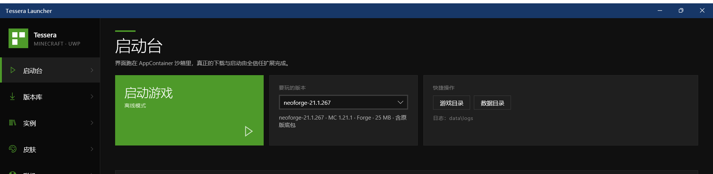 | 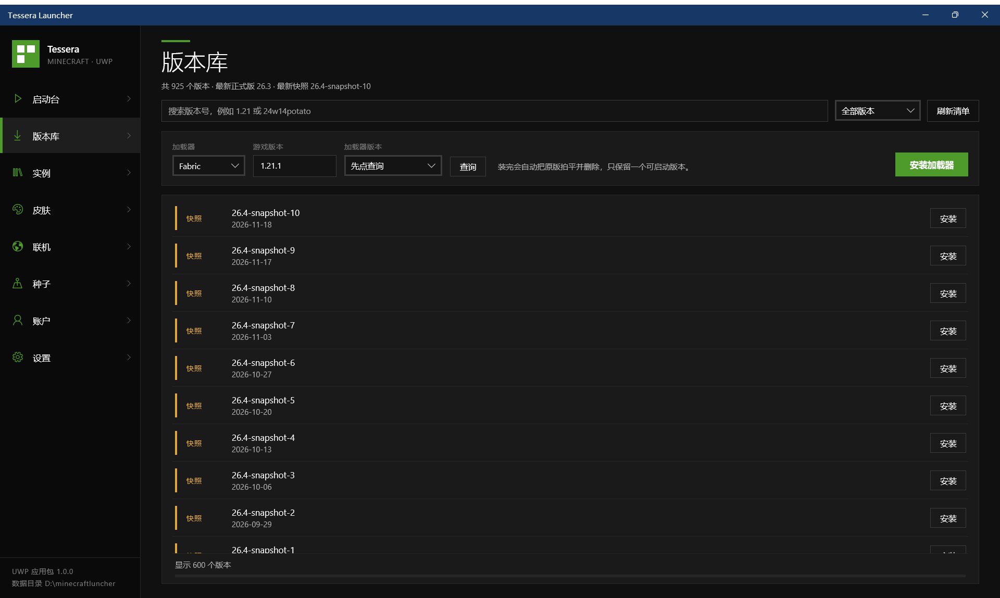 |
| Launch page | Version library |
| 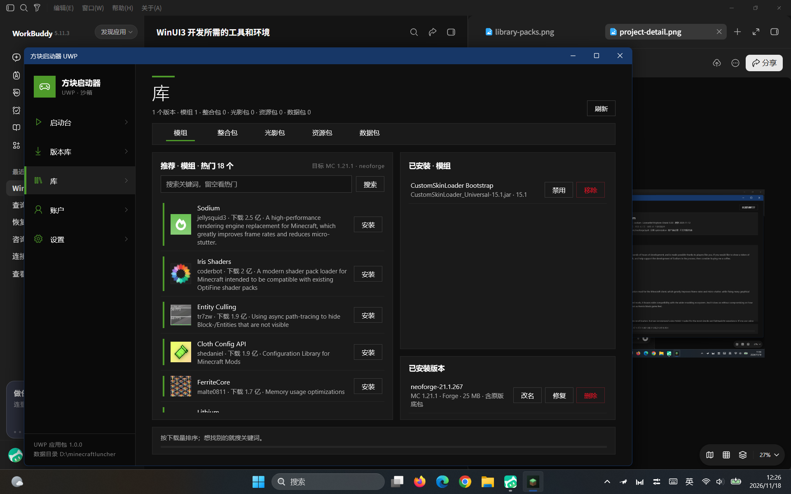 | 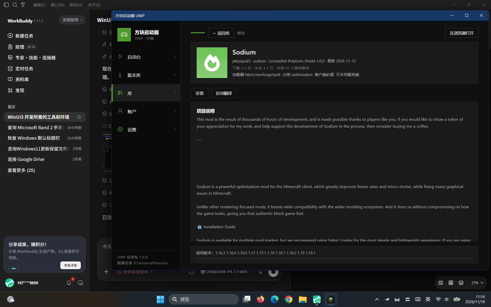 |
| Content library | Project detail |
| 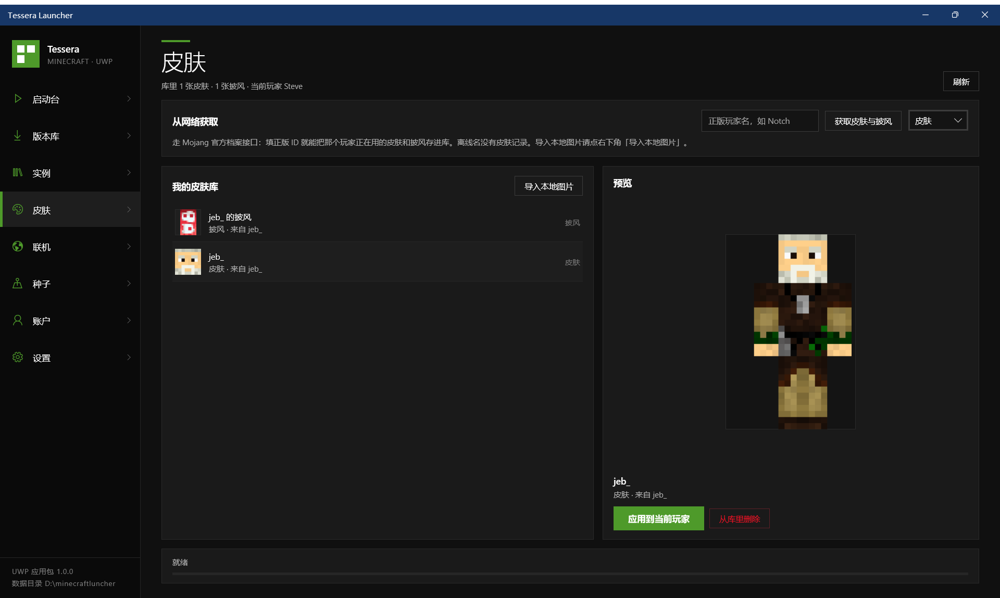 | 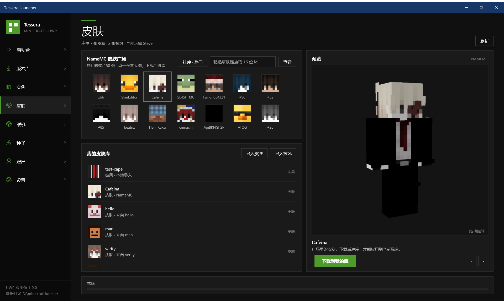 |
| Skin library | 3D preview |
| 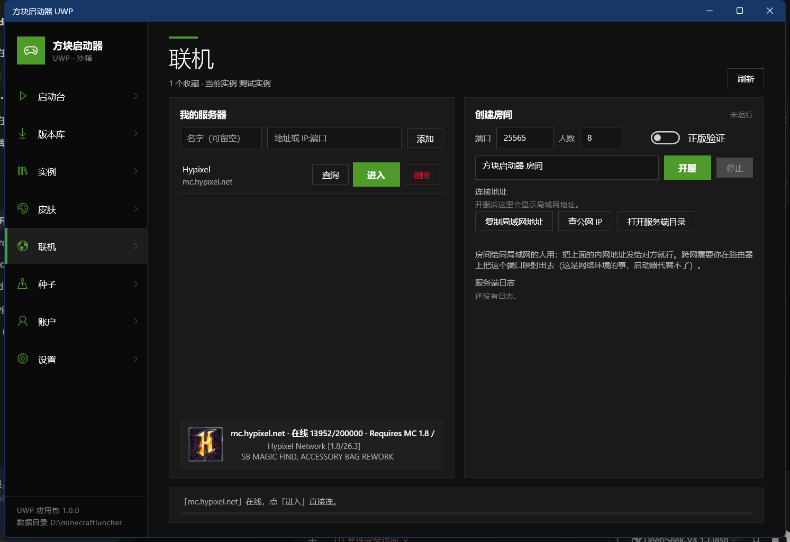 | 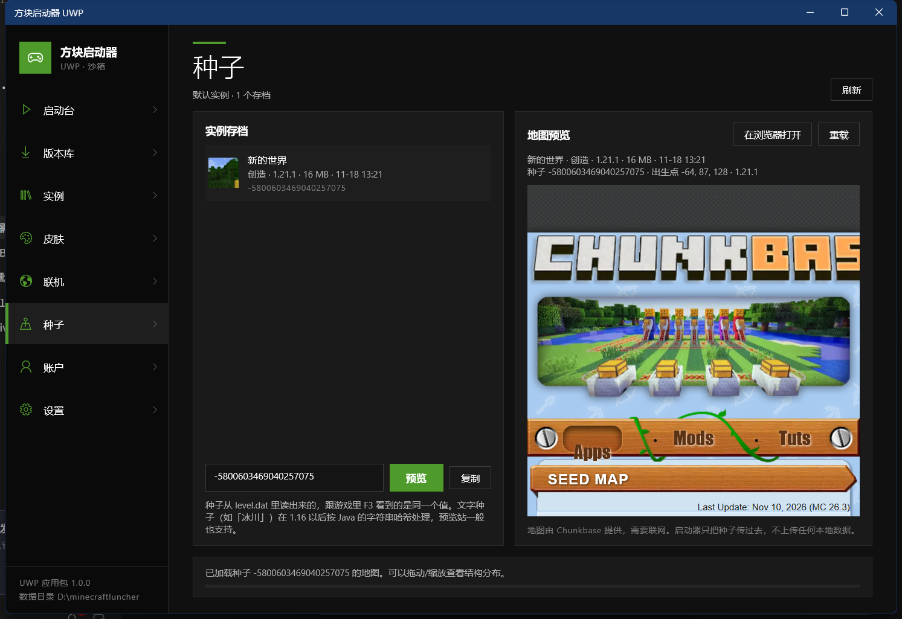 |
| Servers and rooms | Seed map |
| 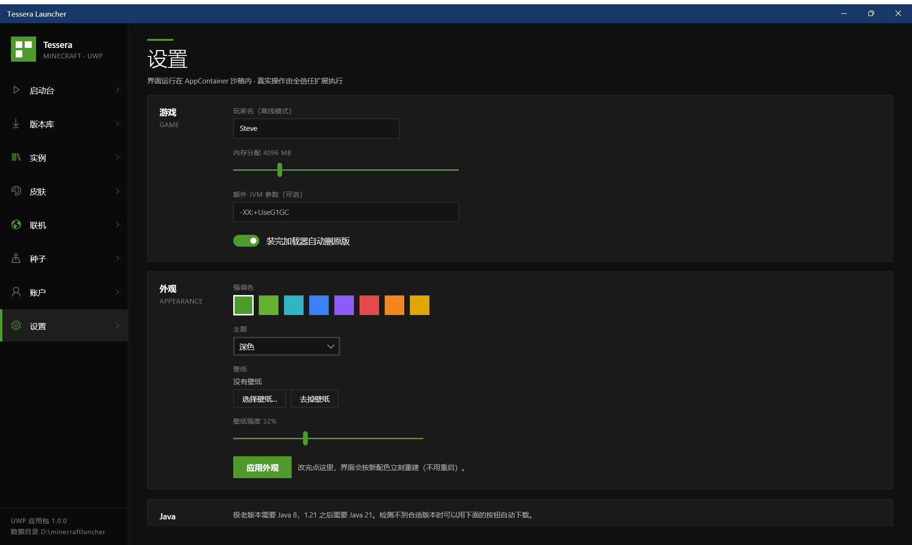 | 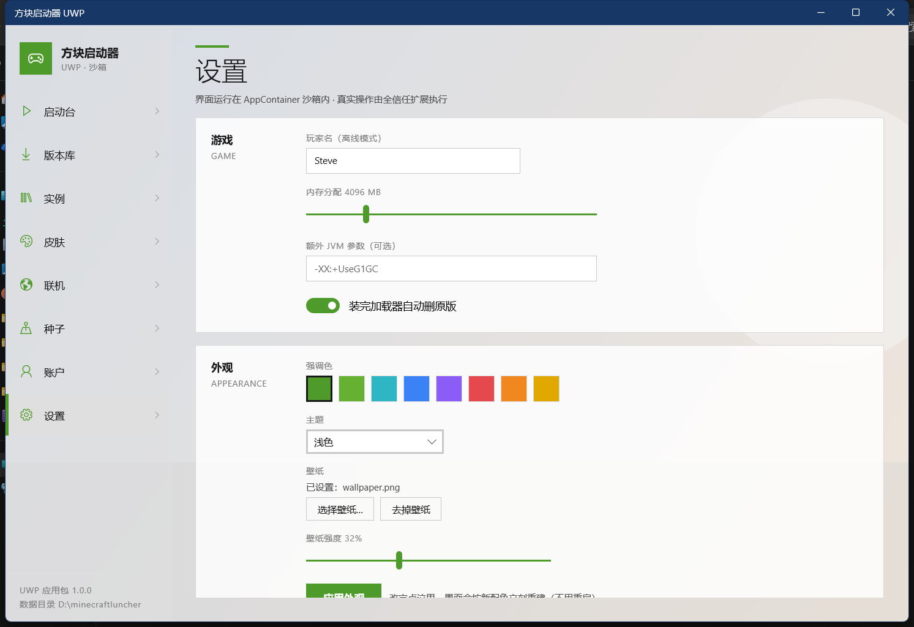 |
| Settings | Appearance |
| 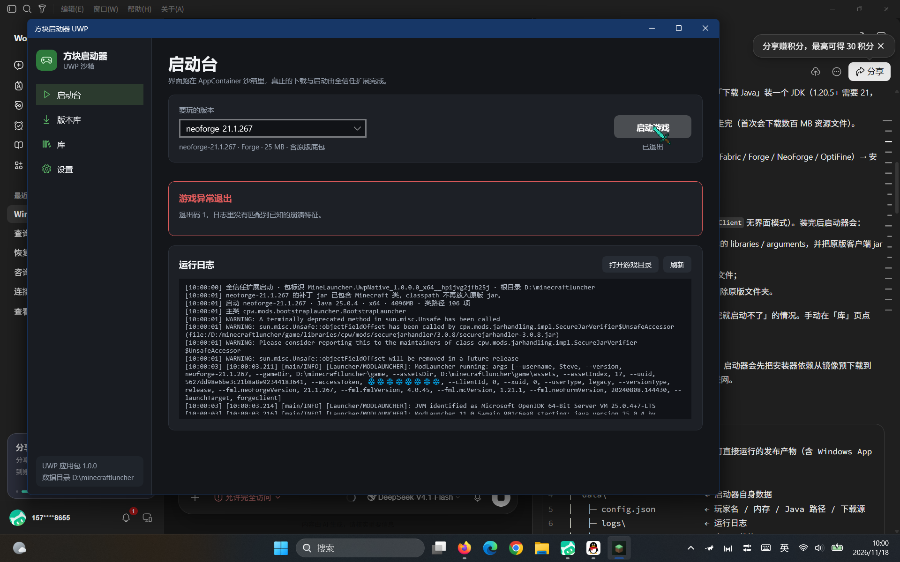 | 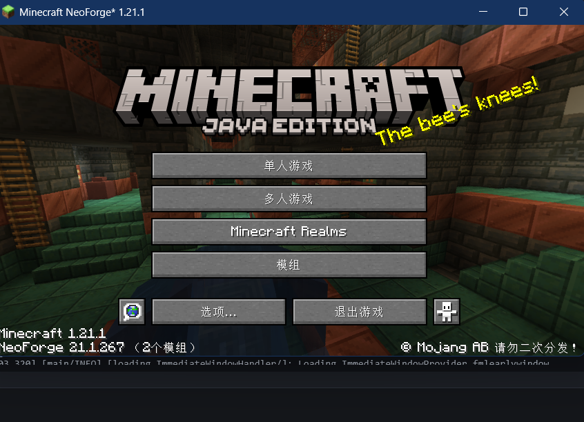 |
| Crash analysis | Game running |

## Disclaimer

Written for learning purposes. Not affiliated with Mojang or Microsoft, and it
ships no game assets. Please buy Minecraft; offline mode is for local testing.
